# Postman-testit

- [Routing ja Middleware](#routing-ja-middleware)
- [CRUD: book ja borrower](#crud-book-ja-borrower)
- [CRUD: Opintorekisteri](#crud-opintorekisteri)

## Routing ja Middleware

Koodi: [routes/example.js](../routes/example.js) ja [app.js](../app.js)

### GET-metodi
`GET http://localhost:3000/example`

### GET-metodi yhdellä parametrilla
`GET http://localhost:3000/example/Jim`

### GET-metodi kahdella parametrilla
`GET http://localhost:3000/example2/Jim/Jones`

### POST-metodi
`POST http://localhost:3000/example` (Body → raw → JSON)

### Middleware-funktio
Palvelimen konsoli: yleinen middleware suoritetaan jokaisella pyynnöllä, `/example`-middleware vain kun polku alkaa `/example`.

## CRUD: book ja borrower

Koodi: [routes/book.js](../routes/book.js), [routes/borrower.js](../routes/borrower.js), [models/book_model.js](../models/book_model.js), [models/borrower_model.js](../models/borrower_model.js) ja [database.js](../database.js)
Tietokanta: [sql/library.sql](../sql/library.sql)

Kaikki kuvat yhtenä PDF-tiedostona: **[CRUD_book_borrower.pdf](CRUD_book_borrower.pdf)**

POST- ja PUT-pyynnöissä data lähetetään muodossa Body → raw → JSON.

### Taulujen rakenne

### Taulu: book

#### READ – GET
`GET http://localhost:3000/book`

#### READ – GET
`GET http://localhost:3000/book/1`

#### CREATE – POST
`POST http://localhost:3000/book`

#### UPDATE – PUT
`PUT http://localhost:3000/book/8`

#### DELETE – DELETE
`DELETE http://localhost:3000/book/8`

### Taulu: borrower

#### READ – GET
`GET http://localhost:3000/borrower`

#### READ – GET
`GET http://localhost:3000/borrower/1`

#### CREATE – POST
`POST http://localhost:3000/borrower`

#### UPDATE – PUT
`PUT http://localhost:3000/borrower/6`

#### DELETE – DELETE
`DELETE http://localhost:3000/borrower/6`

## CRUD: Opintorekisteri

Tietokanta `arviointi`, taulut Opiskelija, Opintojakso ja Arviointi. Yksi opiskelija voi saada monta arviointia, ja yhdellä opintojaksolla voi olla monta arviointia.

Koodi: [routes/opiskelija.js](../routes/opiskelija.js), [routes/opintojakso.js](../routes/opintojakso.js), [routes/arviointi.js](../routes/arviointi.js), mallit kansiossa [models/](../models/) ja yhteys [database_arviointi.js](../database_arviointi.js)

Kaikki kuvat yhtenä PDF-tiedostona: **[CRUD_opintorekisteri.pdf](CRUD_opintorekisteri.pdf)**

POST- ja PUT-pyynnöissä data lähetetään muodossa Body → raw → JSON.

Vierasavainten käsittely:
- Opiskelijan tai opintojakson poisto, kun siihen viitataan Arviointi-taulussa → `409 Conflict`
- Arviointi olemattomalle opiskelijalle tai opintojaksolle → `400 Bad Request`

### Taulu: Opiskelija

#### READ – GET
`GET http://localhost:3000/opiskelija`

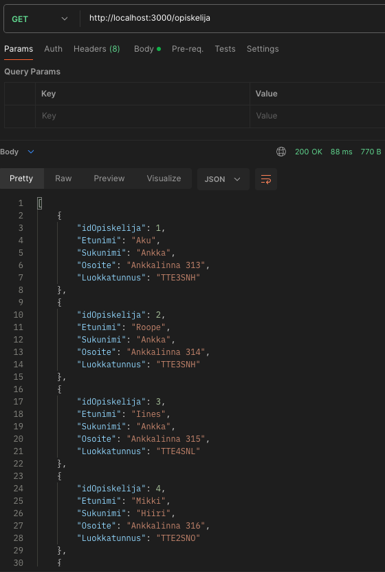

#### READ – GET
`GET http://localhost:3000/opiskelija/1`

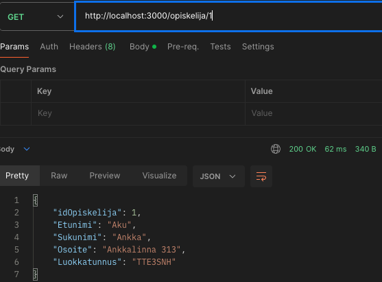

#### CREATE – POST
`POST http://localhost:3000/opiskelija`

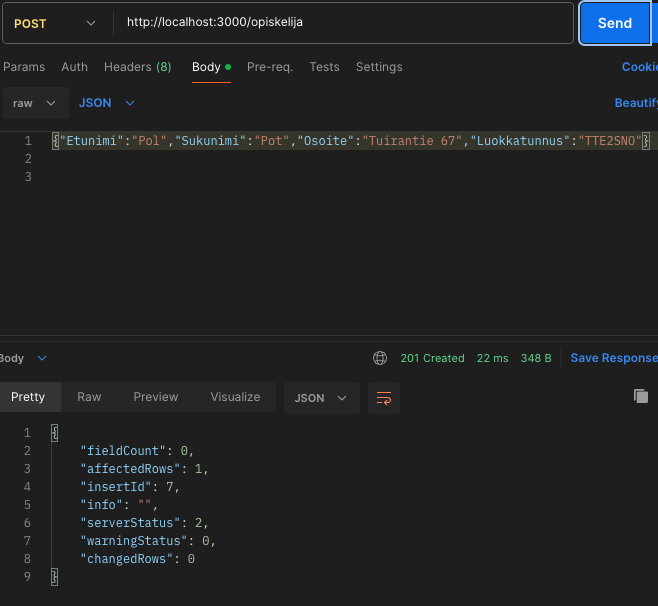

#### UPDATE – PUT
`PUT http://localhost:3000/opiskelija/7`

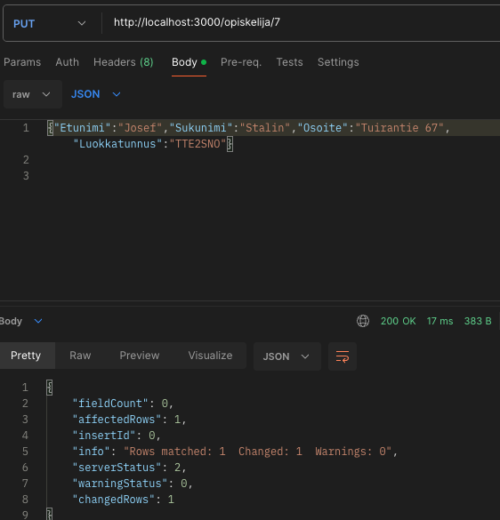

#### DELETE – DELETE
`DELETE http://localhost:3000/opiskelija/7`

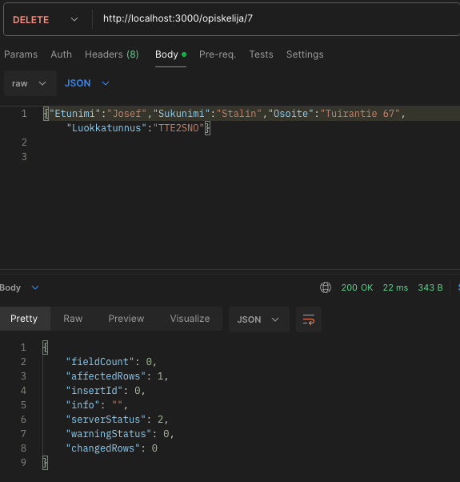

### Taulu: Opintojakso

#### READ – GET
`GET http://localhost:3000/opintojakso`

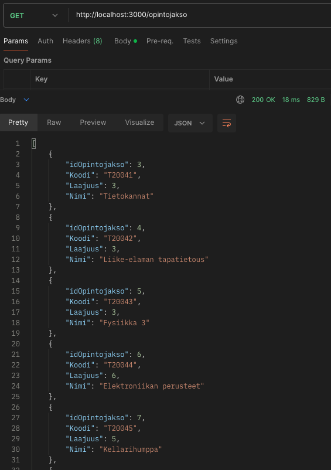

#### READ – GET
`GET http://localhost:3000/opintojakso/3`

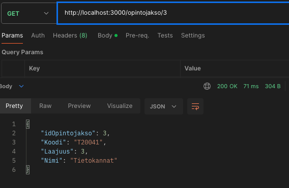

#### CREATE – POST
`POST http://localhost:3000/opintojakso`

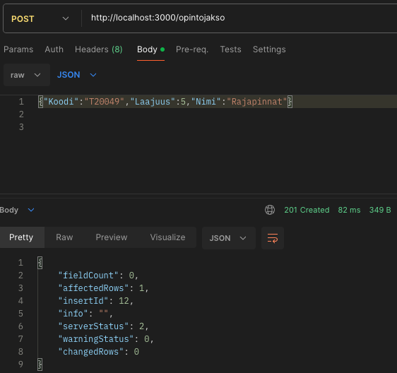

#### UPDATE – PUT
`PUT http://localhost:3000/opintojakso/12`

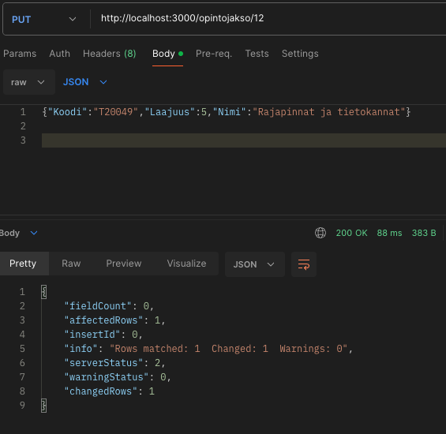

#### DELETE – DELETE
`DELETE http://localhost:3000/opintojakso/12`

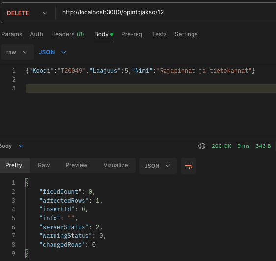

### Taulu: Arviointi

#### READ – GET
`GET http://localhost:3000/arviointi`

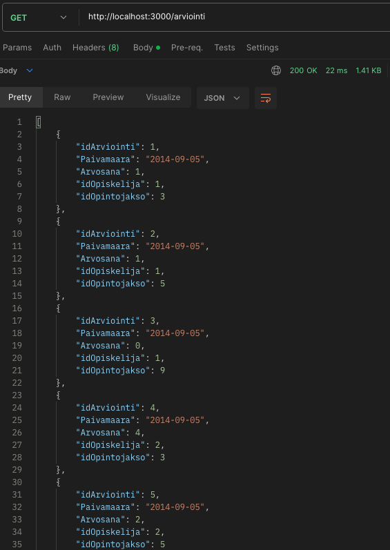

#### READ – GET
`GET http://localhost:3000/arviointi/1`

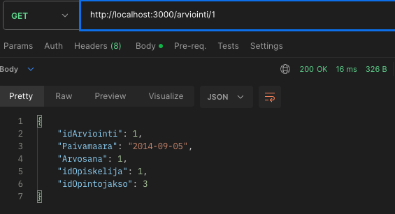

#### CREATE – POST
`POST http://localhost:3000/arviointi`

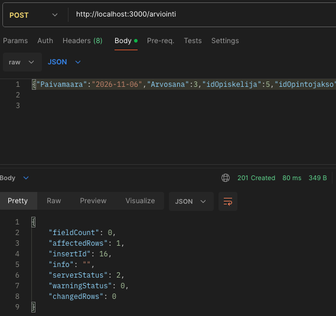

#### UPDATE – PUT
`PUT http://localhost:3000/arviointi/17`

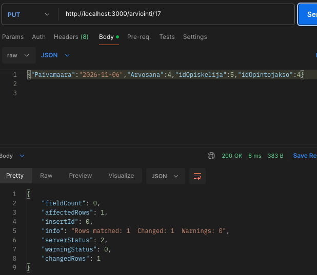

#### DELETE – DELETE
`DELETE http://localhost:3000/arviointi/17`

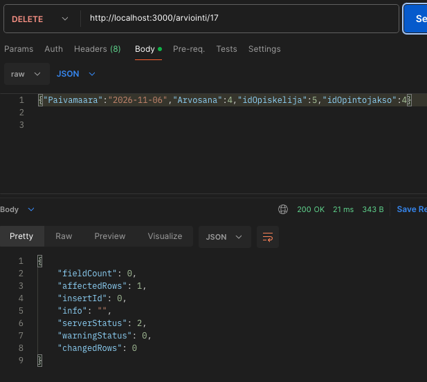
