# Postman-testit

- [Routing ja Middleware](#routing-ja-middleware)
- [CRUD: book ja borrower](#crud-book-ja-borrower)

## Routing ja Middleware

Koodi: [routes/example.js](../routes/example.js) ja [app.js](../app.js)

### GET-metodi
`GET http://localhost:3000/example`

### GET-metodi yhdellä parametrilla
`GET http://localhost:3000/example/Jim`

### GET-metodi kahdella parametrilla
`GET http://localhost:3000/example2/Jim/Jones`

### POST-metodi
`POST http://localhost:3000/example` (Body → raw → JSON)

### Middleware-funktio
Palvelimen konsoli: yleinen middleware suoritetaan jokaisella pyynnöllä, `/example`-middleware vain kun polku alkaa `/example`.

## CRUD: book ja borrower

Koodi: [routes/book.js](../routes/book.js), [routes/borrower.js](../routes/borrower.js), [models/book_model.js](../models/book_model.js), [models/borrower_model.js](../models/borrower_model.js) ja [database.js](../database.js)
Tietokanta: [sql/library.sql](../sql/library.sql)

Kaikki kuvat yhtenä PDF-tiedostona: **[CRUD_book_borrower.pdf](CRUD_book_borrower.pdf)**

POST- ja PUT-pyynnöissä data lähetetään muodossa Body → raw → JSON.

### Taulujen rakenne

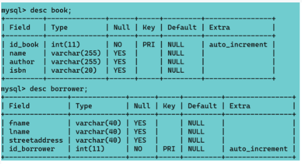

### Taulu: book

#### READ – GET
`GET http://localhost:3000/book`

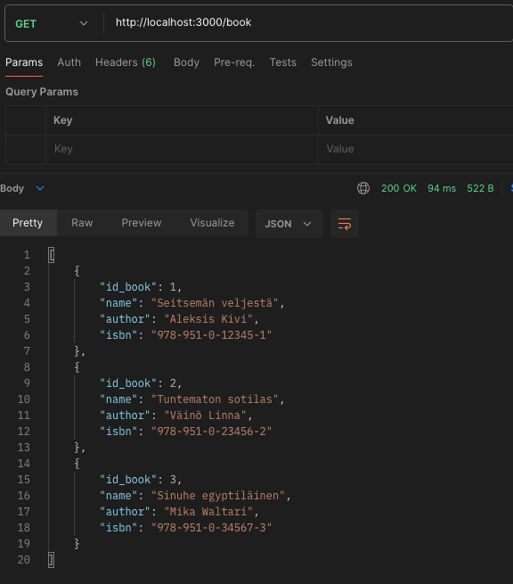

#### READ – GET
`GET http://localhost:3000/book/1`

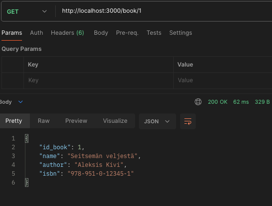

#### CREATE – POST
`POST http://localhost:3000/book`

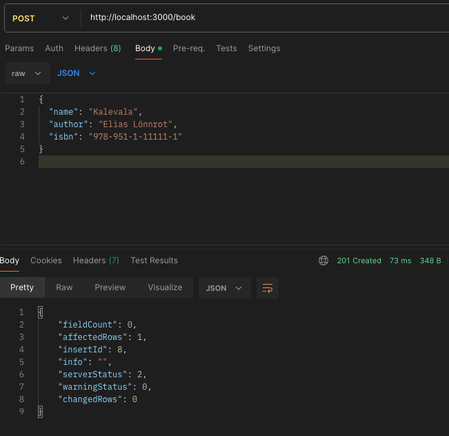

#### UPDATE – PUT
`PUT http://localhost:3000/book/8`

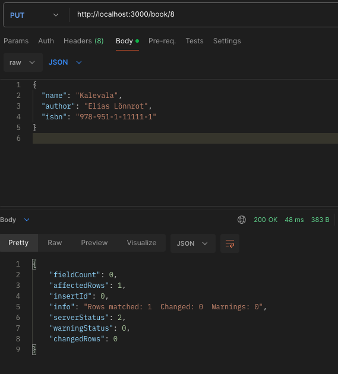

#### DELETE – DELETE
`DELETE http://localhost:3000/book/8`

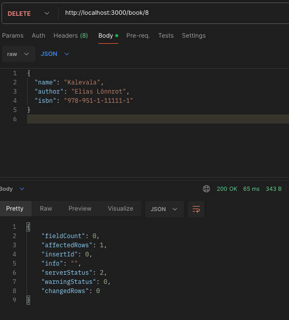

### Taulu: borrower

#### READ – GET
`GET http://localhost:3000/borrower`

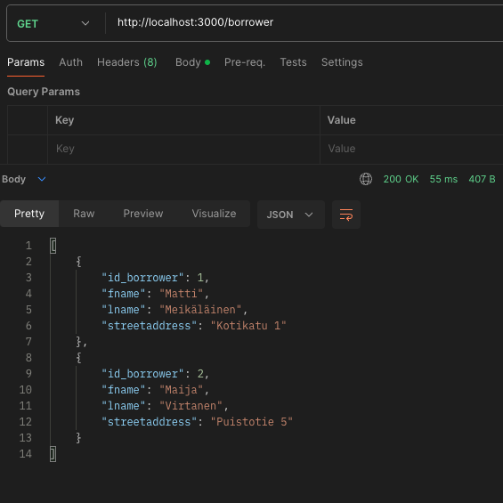

#### READ – GET
`GET http://localhost:3000/borrower/1`

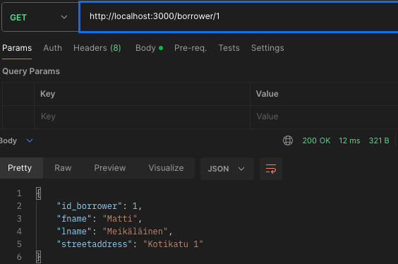

#### CREATE – POST
`POST http://localhost:3000/borrower`

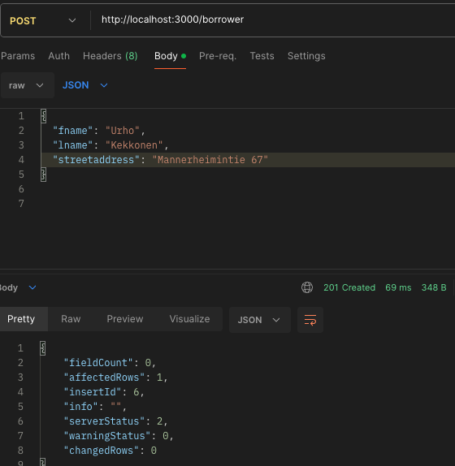

#### UPDATE – PUT
`PUT http://localhost:3000/borrower/6`

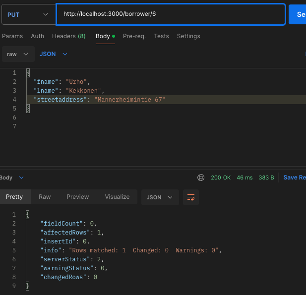

#### DELETE – DELETE
`DELETE http://localhost:3000/borrower/6`

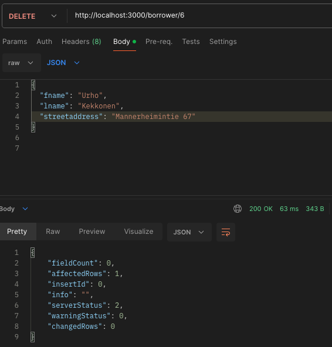
