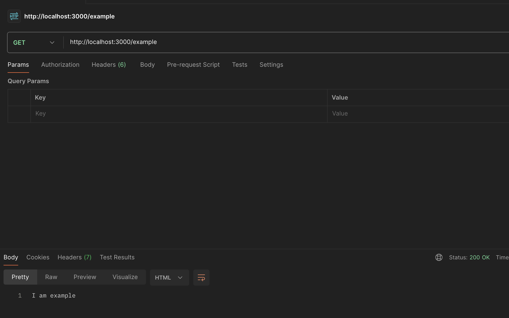
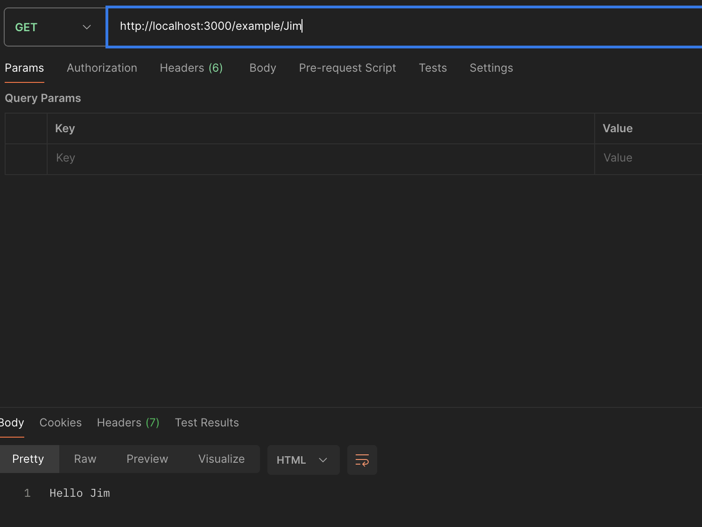
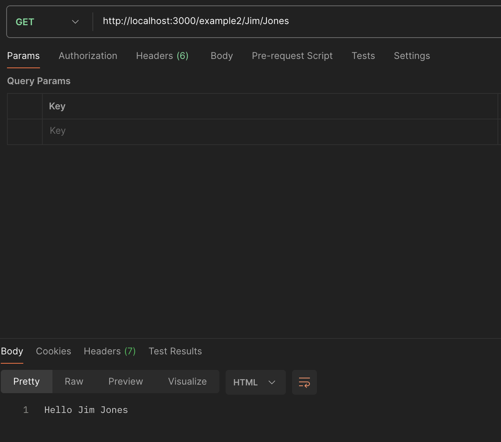
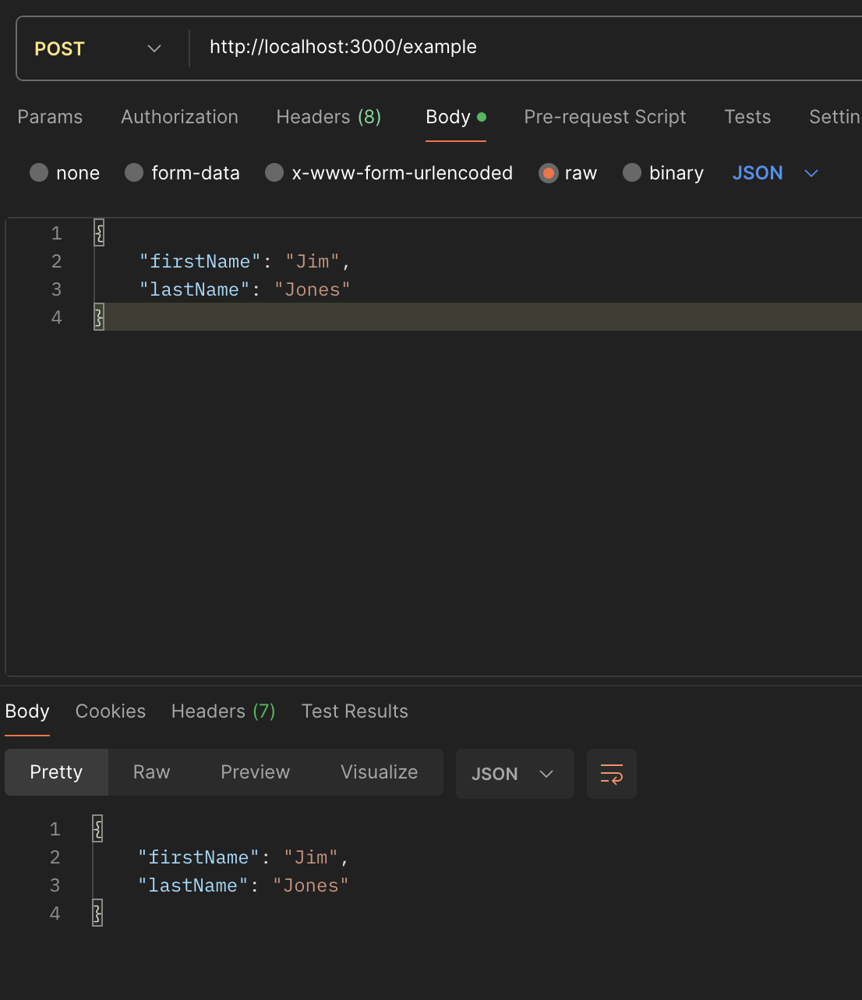
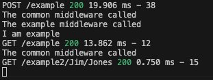

# Postman-testit: Routing ja Middleware

Koodi: [routes/example.js](../routes/example.js) ja [app.js](../app.js)

## GET-metodi
`GET http://localhost:3000/example`

## GET-metodi yhdellä parametrilla
`GET http://localhost:3000/example/Jim`

## GET-metodi kahdella parametrilla
`GET http://localhost:3000/example2/Jim/Jones`

## POST-metodi
`POST http://localhost:3000/example` (Body → raw → JSON)

## Middleware-funktio
Palvelimen konsoli: yleinen middleware suoritetaan jokaisella pyynnöllä, `/example`-middleware vain kun polku alkaa `/example`.

